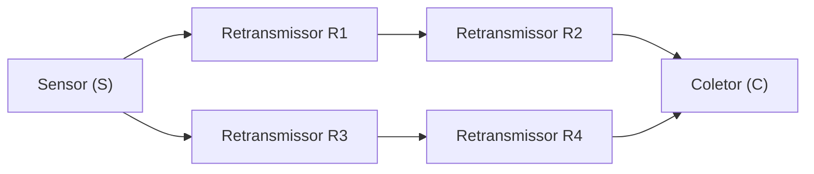

# Relatório Técnico — Rede PRN com Retransmissão

**Curso:** Engenharia de Software — disciplina Redes Móveis, IFG Câmpus Inhumas, 2026/2
**Professor:** Rogério Sousa e Silva
**Integrantes:** Guilherme Alixandre, Gabriel Araújo e Victor Inácio
**Data:** 26/11/2026 (entrega e apresentação em 03/12/2026)

## 1. Objetivo

Implementar e testar uma rede de pacotes (Packet Radio Network) emulada em Python sobre UDP, na qual um
sensor `S` entrega leituras fictícias de temperatura a um coletor `C` por dois caminhos redundantes de
dois retransmissores cada, demonstrando encaminhamento multi-hop, controle de TTL, deduplicação e
tolerância a falhas de nó.

## 2. Diagrama da topologia

O sensor envia uma cópia por caminho desde o início; cada caminho completo tem 3 saltos
(S→R1→R2→C ou S→R3→R4→C), e os dois caminhos usam nós totalmente distintos, o que garante entrega mesmo
se um único retransmissor falhar.

## 3. Formato do pacote e mecanismos de confiabilidade

Cada leitura trafega como um pacote JSON sobre UDP:

| Campo | Exemplo | Função |
| --- | --- | --- |
| tipo | "leitura" | distingue pacote de dados do pacote de controle ("pulso") |
| origem / destino | "S" / "C" | quem gerou a leitura e o coletor final |
| sequencia | 42 | numera as leituras; junto com origem identifica a leitura de forma única |
| ttl | 2 | limite de saltos restantes, decrementado a cada retransmissão |
| temperatura_c | 27.4 | valor fictício transportado |
| criado_em | 1764174900.62 | timestamp de geração; não muda nos saltos — mede a idade do pacote |
| hmac | "9f2a71c4e8b0d5a3" | HMAC-SHA256 com chave fixa pré-compartilhada, recalculado a cada salto |

Além do exigido pelo enunciado (TTL de saltos, dedup, validação de remetente/formato), o protocolo
acrescenta quatro mecanismos de confiabilidade que se complementam, sem depender de handshake ou
confirmação/retransmissão automática (o cenário básico explicitamente dispensa isso):

1. **HMAC por salto** — autentica a origem e detecta corrupção, recalculado a cada salto porque o TTL
   muda (mesma lógica do recálculo de checksum de um cabeçalho IP quando o TTL decrementa).
2. **TTL duplo** — limite de saltos + limite de idade (`criado_em` e `tempo_de_vida_maximo`): descarta
   pacotes "velhos demais" mesmo com saltos sobrando.
3. **Janela de deduplicação com expiração** — os identificadores `(origem, sequencia)` já encaminhados
   são purgados após `janela_dedup_segundos`, evitando crescimento ilimitado de memória.
4. **Pulso de vizinhança** — cada nó avisa periodicamente o próximo salto que está vivo; quem recebe
   detecta ausência prolongada (`vizinho_inativo`/`vizinho_reativado`), sem alterar as contagens de envio
   de dados.

Nenhum desses mecanismos replica a característica que define protocolos como AODV ou DSDV — descoberta e
manutenção de rota sob mobilidade — já que aqui a topologia é fixa e sem descoberta de rota. O HMAC se
aproxima mais da autenticação usada em OSPF/RIPv2; o TTL duplo combina o TTL de saltos do IP com o TTL
temporal do DNS/cache; a janela de dedup e o pulso de vizinhança são técnicas genéricas, presentes em
protocolos de flooding/gossip e em qualquer mecanismo de hello/keepalive.

## 4. Funcionamento

**Sensor (S)** — a cada intervalo (2s por padrão), gera uma temperatura fictícia, incrementa a sequência e
envia uma cópia independente por caminho (R1 e R3), ambas com o mesmo `criado_em` e TTL reduzido em 1 em
relação ao TTL inicial.

**Retransmissores (R1–R4)** — ao receber, validam nessa ordem: remetente permitido (pela porta de origem
do datagrama), formato/tipos dos campos, HMAC, idade (`criado_em`), destino e TTL não negativo. Descartam
se o identificador `(origem, sequencia)` já foi encaminhado; se o TTL recebido for zero, descartam por
limite de saltos; caso contrário encaminham com TTL-1 e HMAC recalculado, só marcando o identificador como
encaminhado depois que o socket aceita o envio.

**Coletor (C)** — valida remetente (R2 ou R4), formato, HMAC, destino e TTL ≥ 0 (aceitando TTL igual a
zero, já que é o destino final). Salva a primeira cópia de cada `(origem, sequencia)` em CSV e registra as
cópias seguintes como duplicata.

**Pulso de vizinhança** — roda no mesmo socket dos dados (campo `tipo: "pulso"`), sem threads: o loop de
recepção usa `socket.settimeout` e, a cada iteração, verifica se é hora de mandar um pulso para o próximo
nó e se algum vizinho de quem recebe dados está em silêncio há tempo demais, registrando
`vizinho_inativo`/`vizinho_reativado`.

## 5. Testes executados

| Teste | Configuração | Evidência esperada |
| --- | --- | --- |
| T1 | Caminho superior (S, R1, R2, C), 10 leituras | Entrega pelos 3 saltos do caminho superior |
| T2 | Os 6 nós, 10 leituras | 10 entregas únicas + 10 duplicatas em C; 60 envios totais na rede |
| T3 | Todos, derruba R1 após a leitura 10 | Leituras 11–20 só pelo caminho R3→R4 |
| T4 | Todos, derruba R2 após a leitura 10 | R1 tenta enviar a R2; caminho R3→R4 mantém 100% de entrega |
| T5 | Todos, derruba R2 e R4 após a leitura 10 | Leituras 11–20 não chegam a C |
| T6 | Todos, TTL inicial = 2 | R2 e R4 recebem TTL 0 e descartam antes de alcançar C |
| T7 | S, R1, R2, C; sensor manda 2 cópias idênticas de 1 leitura | R1 encaminha 1, descarta 1 duplicata, C recebe 1 entrega |

Cada execução grava logs em `logs/<teste>/<no>.jsonl` (JSON Lines, um evento por linha) e o coletor grava
`resultados/leituras_<teste>.csv` com as leituras entregues.

## 6. Resultados consolidados

Números extraídos dos logs reais das execuções (soma de todos os nós, por teste):

| Teste | Geradas | Únicas entregues | Duplicatas | Descarte TTL | Envios totais na rede | Taxa de entrega |
| --- | --- | --- | --- | --- | --- | --- |
| T1 | 10 | 10 | 0 | 0 | 40 | 100% |
| T2 | 10 | 10 | 10 | 0 | 60 | 100% |
| T3 | 20 | 20 | 10 | 0 | 100 | 100% |
| T4 | 20 | 20 | 10 | 0 | 110 | 100% |
| T5 | 20 | 10 | 10 | 0 | 100 | 50% |
| T6 | 10 | 0 | 0 | 20 | 40 | 0% |
| T7 | 1 | 1 | 0 | 0 | 4 | 100% |

Taxa de entrega = 100 × leituras únicas entregues ÷ leituras geradas. Em T2, os números batem exatamente
com a conferência do enunciado: 20 envios do sensor (2 cópias × 10 leituras), 40 encaminhamentos somados
nos 4 retransmissores (10 cada), totalizando 60 envios na rede, com 10 entregas únicas e 10 duplicatas em
C.

## 7. Conferência e interpretação

**Como o salto entre retransmissores alcança C.** Cada caminho completo tem 3 saltos
(S→R1→R2→C ou S→R3→R4→C); o TTL inicial 3 vira TTL 2 na saída do sensor, 1 no segundo salto e 0 no
terceiro, que o coletor aceita por ser o destino final.

**Por que uma falha isolada preserva a entrega.** Os dois caminhos usam nós totalmente distintos
(R1/R2 vs R3/R4); derrubar um único retransmissor (T3, T4) deixa o outro caminho intacto, e como o sensor
sempre envia as duas cópias, a entrega continua em 100% mesmo com metade da rede fora do ar.

**Quais falhas interrompem os dois caminhos.** Só a perda de pelo menos um nó em CADA caminho
simultaneamente corta a entrega por completo — em T5, derrubar R2 e R4 juntos faz as leituras 11–20 não
chegarem mais a C (taxa de entrega cai de 100% para 50%, reproduzindo exatamente a metade do teste que
rodou sem os dois caminhos).

**Tráfego adicional da redundância.** Duplicar o caminho dobra o tráfego de dados: em T2, 10 leituras
geram 60 envios na rede (20 do sensor + 40 dos retransmissores), contra 30 que um único caminho geraria
(10 do sensor + 20 dos retransmissores) — o custo da tolerância a falhas é exatamente 2× a banda de um
caminho único, sem nenhuma retransmissão ou confirmação extra.

**Reconstrução de uma leitura (T2, leitura 1).** `S` gera a leitura 1 e envia a R1 (TTL 2) e R3 (TTL 2) no
mesmo instante; R1 encaminha a R2 com TTL 1, R2 entrega a C com TTL 0 — primeira cópia, registrada como
entrega única; poucos milissegundos depois R3→R4→C entrega a segunda cópia, que C registra como
duplicata. O percurso completo fica reconstituível cruzando `origem`+`sequencia` nos logs de cada nó.

## 8. Limitações da emulação e conclusões

- Os 6 processos rodam na mesma máquina, em `127.0.0.1`; alcance de rádio e fenômenos físicos não são
  simulados.
- Topologia e vizinhança são fixas (sem descoberta de rota), configuradas em `config/topologia.json`.
- O cenário básico não usa confirmação (ACK) nem retransmissão automática de pacotes de dados; um envio
  UDP aceito pelo socket não comprova a chegada ao próximo nó — por isso os logs distinguem tentativa de
  envio, envio aceito pelo socket e recepção confirmada no nó seguinte.

**Conclusão:** os testes T1–T7 confirmaram que a redundância de dois caminhos disjuntos garante 100% de
entrega sob falha de um único nó, ao custo de dobrar o tráfego de dados; os quatro mecanismos de
confiabilidade acrescentados (HMAC, TTL duplo, janela de dedup e pulso de vizinhança) reforçam
autenticidade, atualidade, uso limitado de memória e observabilidade de falhas sem exigir handshake nem
alterar as contagens de entrega exigidas pelo enunciado.

## 9. Repositório

Link do repositório: _a preencher após o push via PyCharm ("Share Project on GitHub")._
